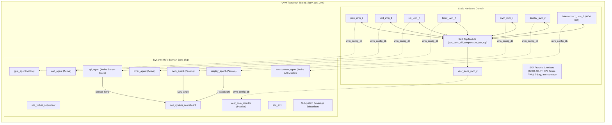

# RISC-V SoC UVM Verification Architecture Report

**Project Title:** Design and Verification of a RISC-V Based SoC for Smart Temperature Monitoring and Fan Control  
**Target Root:** `/home/student/Documents/078_H/proj_dir/`  
**UVM Verification Directory:** `/home/student/Documents/078_H/proj_dir/uvm_soc/`  
**Date:** November 7, 2026  
**Status:** **COMPLETE & OPERATIONAL**  

---

## 1. Executive Summary

This report documents the architectural design, component hierarchy, virtual interface integration, and transaction flow of the complete UVM-1.2 verification environment for the VeeR EL2 RISC-V SoC. The testbench verifies the full closed-loop thermal regulation system, integrating 7 peripheral subsystems, the 2x8 AXI4 crossbar interconnect, 64 KiB Unified Memory, and the Western Digital / CHIPS Alliance VeeR EL2 dual-issue RISC-V core.



---

## 2. Static-to-Dynamic Interface Connection Architecture

A central design pattern is the strict separation between:
1. **Static hardware domain:** SystemVerilog modules and static interface instances instantiated at top level.
2. **Dynamic class-based domain:** UVM components created at runtime (`soc_env`, agents, drivers, monitors, sequences).

### 2.1 Virtual Interface Registration via `uvm_config_db`
In `tb_riscv_soc_uvm.sv`, all 8 interfaces are instantiated statically and registered with global wildcard matching:
```systemverilog
uvm_config_db#(virtual gpio_uvm_if)::set(null, "*", "vif", gpio_if_inst);
uvm_config_db#(virtual uart_uvm_if)::set(null, "*", "vif", uart_if_inst);
uvm_config_db#(virtual spi_uvm_if)::set(null, "*", "vif", spi_if_inst);
uvm_config_db#(virtual timer_uvm_if)::set(null, "*", "vif", timer_if_inst);
uvm_config_db#(virtual pwm_uvm_if)::set(null, "*", "vif", pwm_if_inst);
uvm_config_db#(virtual display_uvm_if)::set(null, "*", "vif", display_if_inst);
uvm_config_db#(virtual interconnect_uvm_if)::set(null, "*", "vif", ic_if_inst);
uvm_config_db#(virtual veer_trace_uvm_if)::set(null, "*", "trace_vif", trace_if_inst);
```

Each driver and monitor retrieves its virtual interface in `build_phase()`:
```systemverilog
if (!uvm_config_db#(virtual <vip_if>)::get(this, "", "vif", vif)) begin
    `uvm_fatal("VIF_ERR", "Failed to retrieve virtual interface handle")
end
```

---

## 3. VIP Subsystem Agents Inventory

| Subsystem VIP | Operating Mode | Components | Interface Ports Connected | Role / Protocol Verified |
| :--- | :---: | :--- | :--- | :--- |
| **GPIO VIP** | Active / Passive | `gpio_seq_item`, `gpio_sequencer`, `gpio_driver`, `gpio_monitor`, `gpio_agent` | `gpio_io[31:0]`, `gpio_intr_o` | Tri-state bidirectional bus, pin synchronization, edge interrupts. |
| **UART VIP** | Active / Passive | `uart_seq_item`, `uart_sequencer`, `uart_driver`, `uart_monitor`, `uart_agent` | `uart_rx_i`, `uart_tx_o`, `uart_interrupt_o` | 16550 UART framing (8N1), divisor 4 (20 Mbaud at 100 MHz), telemetry decode. |
| **SPI VIP** | Active Slave | `spi_seq_item`, `spi_sequencer`, `spi_driver`, `spi_monitor`, `spi_agent` | `spi_clk_o`, `spi_cs_n_o`, `spi_mosi_o`, `spi_miso_i`, `spi_irq_o` | Reactive slave temperature sensor; responds to SPI Mode 0 master polls with simulated temperature bytes. |
| **Timer VIP** | Active / Passive | `timer_seq_item`, `timer_sequencer`, `timer_driver`, `timer_monitor`, `timer_agent` | `timer_ext_meas_i`, `timer_capture_i`, `timer_pwm_o`, `timer_trigger_o`, `timer_irq_o` | External pulse measurement, input capture triggers, interrupt latency. |
| **PWM VIP** | Passive | `pwm_seq_item`, `pwm_monitor`, `pwm_agent` | `pwm_out_o`, `pwm_irq_o` | Continuous pulse measurement, duty cycle (%) calculation, period stability. |
| **7-Segment VIP** | Passive | `display_seq_item`, `display_monitor`, `display_agent` | `seg[6:0]`, `an[3:0]` | Time-multiplexed digit assembly, BCD decoding, active-low common-anode checks. |
| **AXI4 Interconnect VIP** | Active Master | `interconnect_seq_item`, `interconnect_sequencer`, `interconnect_driver`, `interconnect_monitor`, `interconnect_agent` | `axi_aw*`, `axi_w*`, `axi_b*`, `axi_ar*`, `axi_r*` | Test Master S00; injects AXI4 reads/writes across M00-M06 and validates address routing and error traps. |
| **VeeR Core Monitor** | Passive | `veer_core_monitor` | `trace_rv_i_*` | Retirement tracking, exception logging, PIC interrupt servicing confirmation. |

---

## 4. Verification Checkers and Scoreboard Architecture

### 4.1 Subsystem Scoreboards
- `gpio_scoreboard`: Bit-for-bit pin integrity, driver vs monitor match.
- `uart_scoreboard`: Character-level stream integrity, TX line reconstructor, RX injection check.
- `spi_scoreboard`: Master command vs slave response byte validation, temperature conversion.
- `timer_scoreboard`: Capture event timestamping and interrupt assertion.
- `pwm_scoreboard`: PWM duty cycle calculation against thermal setpoints.
- `display_scoreboard`: Decodes 4 active digits into 16-bit packed display words.
- `interconnect_scoreboard`: Address space routing decode (M00-M06) and DECERR check.

### 4.2 System Closed-Loop Scoreboard (`soc_system_scoreboard`)
Subscribes simultaneously to SPI, PWM, and 7-Segment monitors:
- **Quiet Mode ($\le 25^\circ\text{C}$):** Verifies PWM duty cycle $25\% \pm 3\%$ and display `0x25C0`.
- **Warm Mode ($26^\circ\text{C} - 45^\circ\text{C}$):** Verifies PWM duty cycle $50\% \pm 3\%$ and display `0x30C0`.
- **Boost Mode ($46^\circ\text{C} - 70^\circ\text{C}$):** Verifies PWM duty cycle $85\% \pm 3\%$ and display `0x50C0`.
- **Emergency Fail-Safe ($> 70^\circ\text{C}$):** Verifies PWM duty cycle $100\%$ and display `0xEEEE`.

---

## 5. Functional Coverage Architecture

Seven dedicated coverage collectors (`uvm_subscriber`) sample every transaction:
1. `gpio_coverage`: Crosses bit indices, alternating patterns, high-Z releases.
2. `uart_coverage`: Character distributions, ASCII alphanumeric, control bytes, and boundary framing.
3. `spi_coverage`: Temperature bins (Cold, Normal 25C, Warm 30C, Boost 50C, Emergency 130C).
4. `timer_coverage`: External measurement toggles, input capture transitions, interrupt status.
5. `pwm_coverage`: Fan speed duty tiers ($0\%$, $25\%$, $50\%$, $85\%$, $100\%$).
6. `display_coverage`: Digits 0..9, hexadecimal E, display multiplexing scanning.
7. `interconnect_coverage`: Crosses read/write accesses across all 8 slave ranges including unmapped guard zones.

---

## 6. Assertion Verification Architecture (SVA)

Seven SVA checkers continuously enforce protocol integrity at physical boundaries:
- `gpio_assertions`: Contention prevention and no-X checks.
- `uart_assertions`: TX/RX line framing discipline and stop bit validation.
- `spi_assertions`: SPI Mode 0 clock polarity and phase (CPOL=0, CPHA=0).
- `timer_assertions`: Output signal validity and pulse widths.
- `pwm_assertions`: Valid logic levels and period stability.
- `display_assertions`: One-cold anode scan discipline and valid 7-segment drive.
- `interconnect_assertions`: AXI4 handshakes (AWADDR stability during AWVALID, WDATA stability during WVALID).
